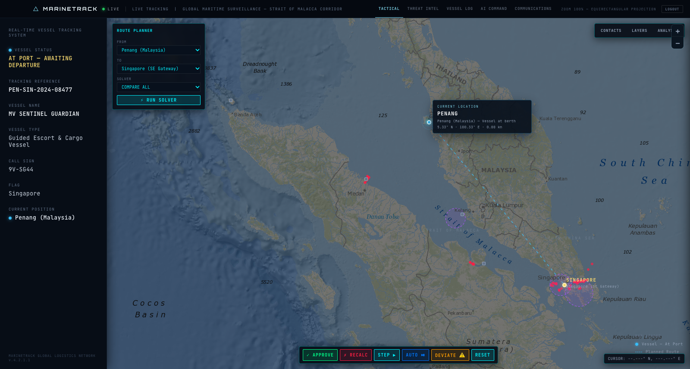
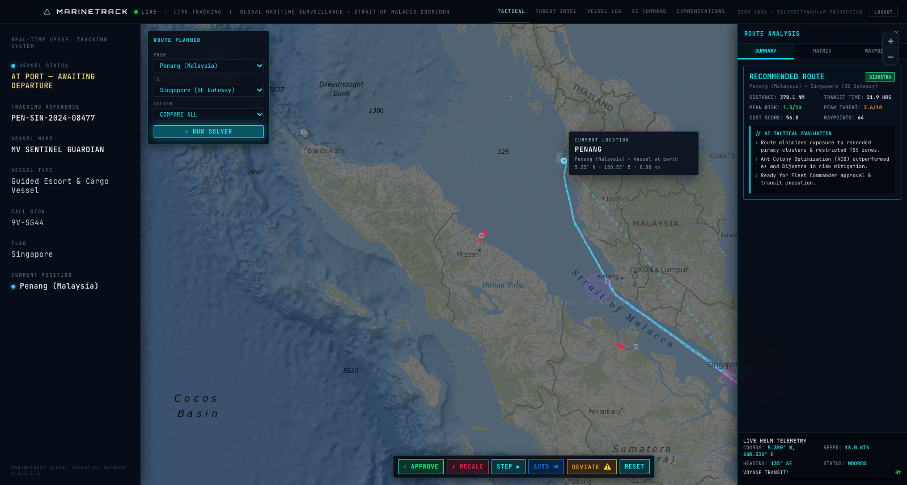
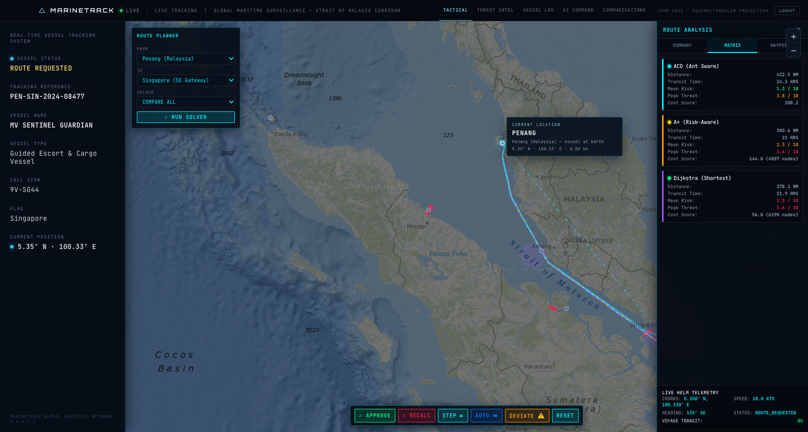
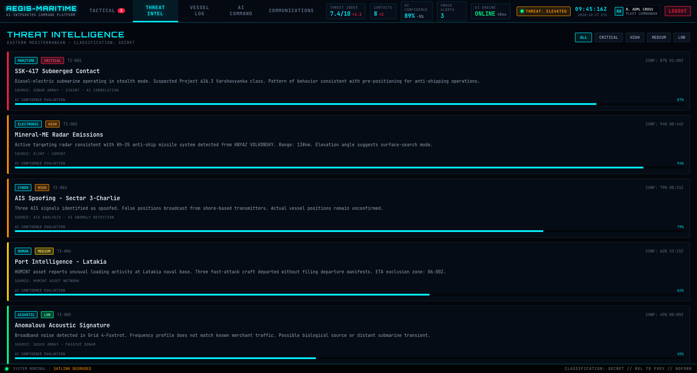
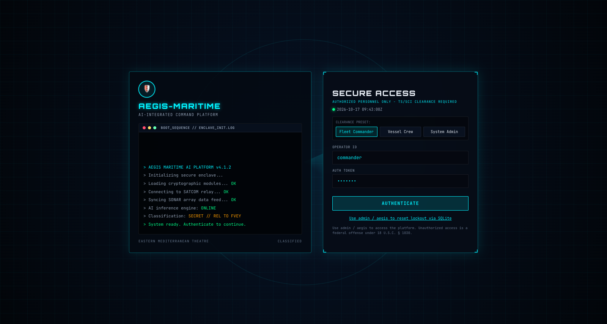

# AI Swarm Intelligence: Maritime Fleet Defense & Route Optimization

Autonomous maritime fleet defense and dynamic route planning platform for high-risk maritime corridors (Strait of Malacca). The system combines Ant Colony Optimization (ACO), A* Search, and Dijkstra pathfinding with machine learning risk classification, real-time threat monitoring, and fleet commander tactical control.

---

## UI Previews & Tactical Screenshots

### 1. Tactical Fleet Commander Dashboard
Live satellite-tracked maritime surveillance across the Strait of Malacca, displaying real-time vessel telemetry, waypoint corridors, and active piracy incident clusters.



### 2. Swarm Intelligence Route Optimization (ACO vs. Baselines)
Ant Colony Optimization constructs water-only candidate routes avoiding land masses, restricted traffic separation schemes (TSS), and piracy hotspots using synthetic pheromone concentration and heuristic desirability.



### 3. Quantitative Multi-Algorithm Decision Matrix
Direct performance benchmark comparing Ant Colony Optimization (ACO), A* (Risk-Aware), and Dijkstra (Shortest Path) across Nautical Distance, Estimated Transit Time, Mean Risk, Peak Threat Level, and Total Cost Score.



### 4. Real-Time Threat Intelligence Center
Live sensor correlation combining acoustic, electronic, radar, AIS spoofing, and port intelligence feeds with real-time AI confidence scores.



### 5. Multi-Role Authentication & Access Control
Secure role-based access control (RBAC) supporting Fleet Commander, Vessel Crew, and System Administrator privileges with automated security logging.



---

## Project Architecture & Contributions

This project was developed collaboratively in two major phases:

- **Base Architecture & Foundation (Manya Nayak)**:
  - Designed the core Ant Colony Optimization (ACO) probabilistic transition and pheromone update engine (`aco_engine.py`).
  - Implemented the Random Forest ML Piracy Risk Classifier (`risk_classifier_ai.py`) trained on historical incident datasets (`pirate_attacks.csv`).
  - Built the discrete coordinate-to-nautical grid mapping and maritime simulation environment (`maritime_environment.py`).
  - Developed the complete system workflow state machine (`workflow_system.py`) and base interactive web application (`app.py`).
  - Authored the core prototype simulation pipelines (`run_prototype.py`, `ai.py`).

- **Dashboard Enhancements & Modernization (Khushi Srivastava)**:
  - Refactored server architecture to FastAPI (`app/main.py`) with SQLite credential management (`database.py`).
  - Enhanced water-only pathfinding algorithms (`pathfinding.py`) and integrated global land masking.
  - Redesigned and modernised the frontend UI into the MARINETRACK dark command aesthetic (`static/css/style.css`, `static/js/app.js`, `templates/index.html`).
  - Configured local deployment environments and documentation.

---

## Prerequisites

- Python 3.10 or newer
- Git

Verify Python installation:

```bash
python --version
# Or python3 --version
```

---

## Installation & Setup

1. **Clone the repository:**
   ```bash
   git clone https://github.com/srivastavakhushi/AI_Swarm-Intelligence.git
   cd AI_Swarm-Intelligence
   ```

2. **Create and activate a virtual environment:**
   - **macOS / Linux:**
     ```bash
     python3 -m venv .venv
     source .venv/bin/activate
     ```
   - **Windows (PowerShell):**
     ```powershell
     python -m venv .venv
     .\.venv\Scripts\Activate.ps1
     ```

3. **Install dependencies:**
   ```bash
   pip install --upgrade pip
   pip install fastapi uvicorn numpy pandas global-land-mask matplotlib scikit-learn
   ```

---

## Running the Dashboard

Start the FastAPI application with Uvicorn:

```bash
python -m uvicorn app.main:app --reload --port 5050
```

Alternatively, run:

```bash
python -m app.main
```

Open your browser and navigate to:
```text
http://127.0.0.1:5050
```

### Sign-in Credentials

Default accounts are auto-initialized in `users.db`:

| Operator ID | Password | Role | Access Level |
| :--- | :--- | :--- | :--- |
| `commander` | `test123` | Fleet Commander | Full Tactical Approval & Recalculation |
| `crew` | `test123` | Vessel Crew | Transit Monitoring & Deviation Reports |
| `admin` | `test123` | System Administrator | Database & Account Unlock Management |

---

## Standalone Prototypes & Algorithms

- **Terminal End-to-End Simulation Pipeline:**
  ```bash
  python run_prototype.py
  ```

- **Trained AI Risk Classifier Evaluation:**
  ```bash
  python risk_classifier_ai.py
  ```

- **Standalone Swarm Routing Engine:**
  ```bash
  python ai.py
  ```
