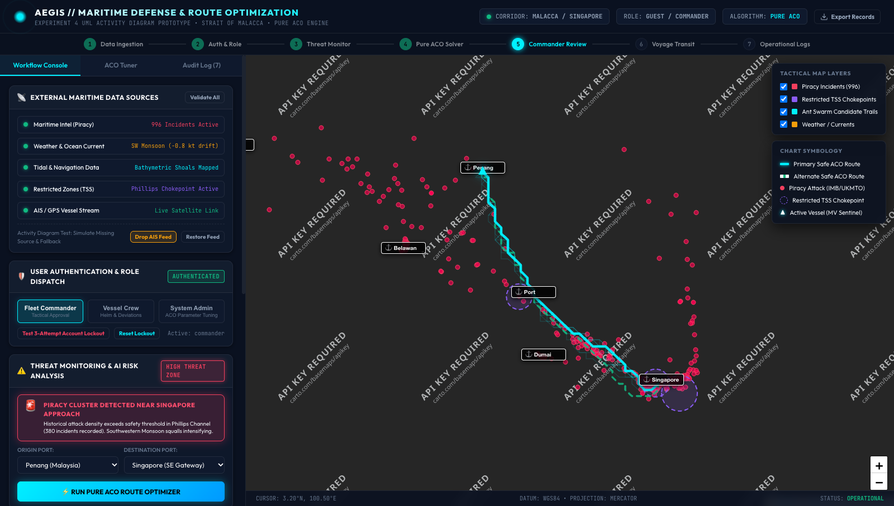
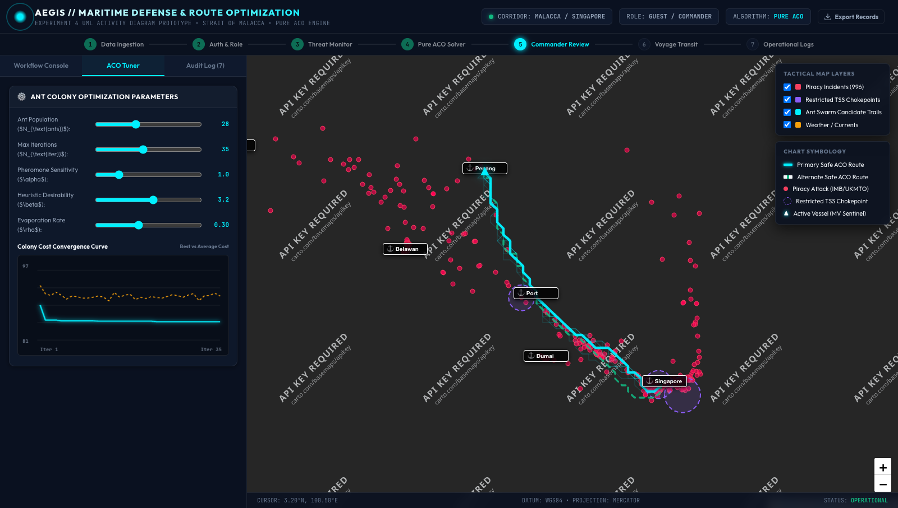
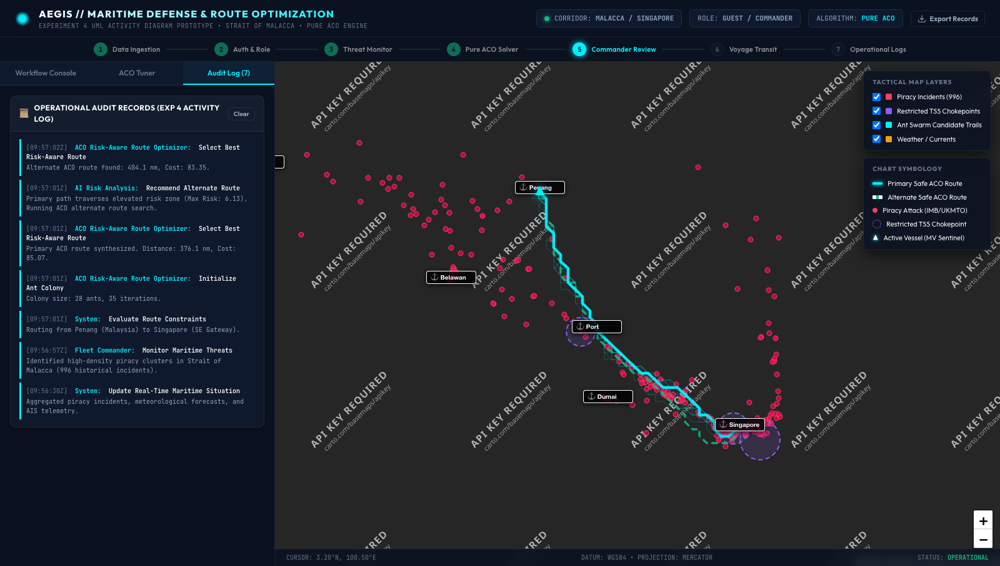
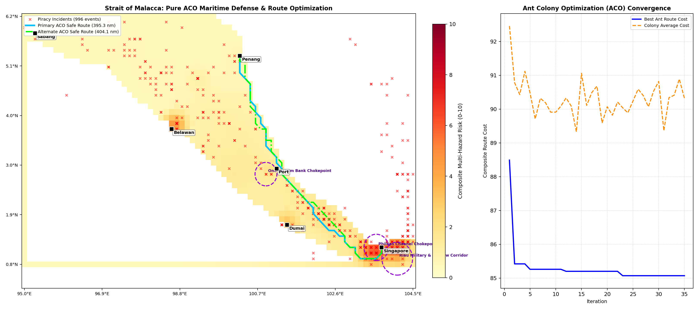
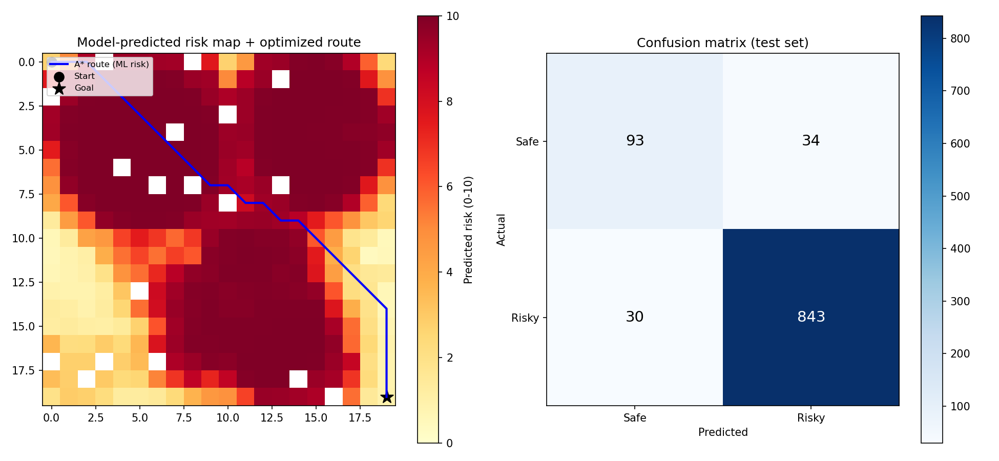
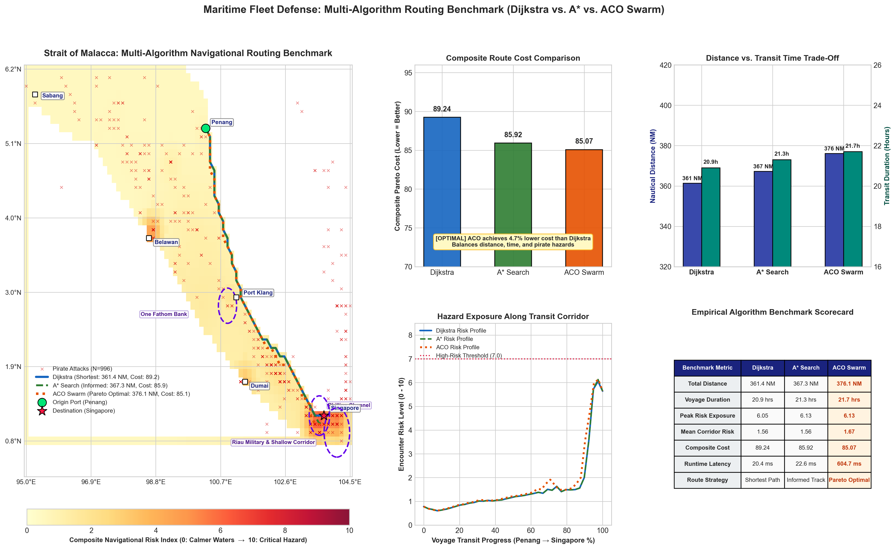
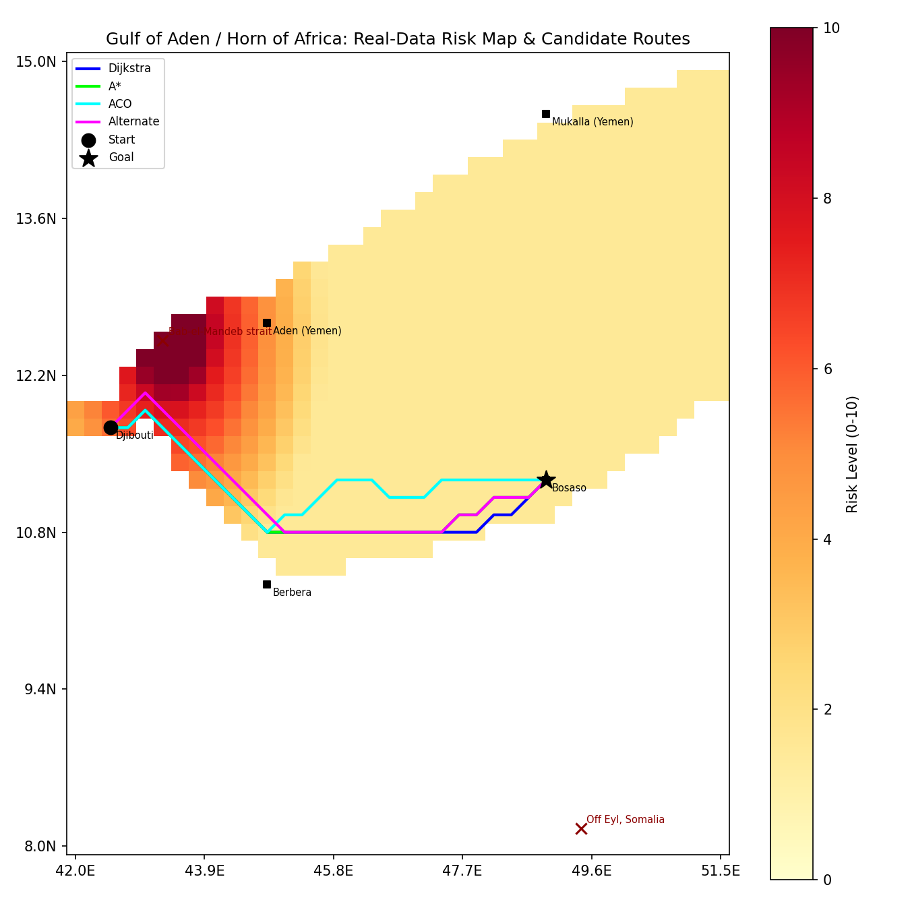

# AEGIS: Maritime Fleet Defense & Pure ACO Route Optimizer

### Experiment 4 Prototype • Autonomous Maritime Swarm Intelligence & Risk-Aware Navigation

Autonomous maritime fleet defense and dynamic route planning system for high-risk maritime corridors (Strait of Malacca). This project implements the core foundational architecture and all swimlanes from the **Software Engineering Experiment 4 UML Activity Diagram**:

- **External Maritime Data Feeds**: Real-time integration of historical piracy intelligence (996 incidents), Southwest Monsoon current drift, bathymetric navigational shoals, and restricted TSS chokepoints.
- **Multi-Role Authentication & Security**: Role-based dispatch (Fleet Commander, Vessel Crew, System Admin) with a 3-attempt account lockout mechanism.
- **Threat Monitoring & AI Risk Analysis**: Real-time threat zone detection and piracy cluster alerts.
- **Pure Ant Colony Optimization (ACO) Engine**: Probabilistic ant swarm path construction with synthetic pheromone evaporation and heuristic desirability.
- **Fleet Commander Review Loop**: Tactical route approval and dynamic recalculation trigger.
- **Vessel Crew Voyage Transit**: Step-by-step route transit simulation and deviation reporting.
- **Operational Audit Logging**: Complete immutable event logging and JSON record export.

---

## Base Model Screenshots & UI Previews

### 1. Interactive Command Dashboard & ACO Route Synthesis
The primary base dashboard showcasing the 7-stage UML Activity Diagram progress stepper, external telemetry feeds, threat detection alerts, and the synthesized water-navigable ACO safe route on the interactive maritime map.



### 2. Ant Colony Optimization (ACO) Parameter Tuner & Convergence
Interactive tuner interface allowing real-time parameter configuration (Ant Population $N_{\text{ants}}$, Max Iterations, Pheromone Sensitivity $\alpha$, Heuristic Desirability $\beta$, Evaporation Rate $\rho$) along with live Colony Route Cost Convergence curves.



### 3. Operational Audit & Event Logging
Immutable audit log recording every automated transition, ACO candidate evaluations, risk score computations, and commander approvals.



---

## Algorithmic Prototype & Machine Learning Visualizations

### 1. Pure ACO Maritime Route Optimization & Cost Minimization
Autonomous Ant Colony Optimization pathfinding across the Strait of Malacca displaying the primary safe corridor (395.3 NM), alternate route (404.1 NM), and iterative composite route cost minimization over 35 iterations.



### 2. Machine Learning Piracy Risk Classifier & Confusion Matrix
Random Forest classification predicting maritime cell risk levels from historical incident data, showing the model-predicted risk heatmap alongside the test-set confusion matrix (843 true risky, 93 true safe).



### 3. Multi-Algorithm Navigational Benchmark (Dijkstra vs. A* vs. ACO Swarm)
Comprehensive comparative evaluation of deterministic shortest-path (**Dijkstra**), heuristic graph search (**A\***), and nature-inspired swarm optimization (**ACO Swarm**) across the Penang-to-Singapore maritime corridor in the Strait of Malacca:

- **Spatial Nautical Trajectories**: Waypoint tracks overlaid on the $45 \times 75$ multi-hazard risk surface ($996$ localized pirate boarding events + TSS chokepoints).
- **Composite Route Cost**: Multi-objective Pareto evaluation where **ACO achieves 85.07** (optimal), outperforming Dijkstra (**89.24**) by 4.7% in overall multi-factor risk suppression.
- **Distance vs. Transit Time**: Trade-off analysis showing ACO trades +14.7 NM (+0.8 hrs) for safe, deep-water clearance away from shallow coastal shoals off Port Klang.
- **Dynamic Threat Exposure**: Cell-by-cell hazard encounter curves along voyage transit progress.
- **Empirical Scorecard**: Side-by-side performance metrics table.



### 4. Legacy Prototype Candidate Evaluation (Gulf of Aden)
Candidate route comparison on the initial Gulf of Aden prototype evaluating shortest path (Dijkstra), heuristic risk penalty (A*), and probabilistic swarm optimization (ACO).



---

## Repository Structure & Core Modules

| File | Description |
| :--- | :--- |
| [`aco_engine.py`](aco_engine.py) | Pure Ant Colony Optimization (ACO) probabilistic engine and pheromone update rules |
| [`pathfinding.py`](pathfinding.py) | Graph search router implementing Dijkstra and A* algorithms for benchmark comparison |
| [`generate_algo_comparison.py`](generate_algo_comparison.py) | Standalone benchmark generator script (Dijkstra vs. A* vs. ACO) |
| [`algorithm_comparison_benchmark.png`](algorithm_comparison_benchmark.png) | High-resolution multi-algorithm routing and Pareto cost benchmark chart |
| [`risk_classifier_ai.py`](risk_classifier_ai.py) | Random Forest ML piracy risk model trained on historical incident data |
| [`maritime_environment.py`](maritime_environment.py) | Discrete coordinate grid, nautical distance calculations, and hazard maps |
| [`workflow_system.py`](workflow_system.py) | State-machine workflow engine coordinating all Experiment 4 swimlanes |
| [`app.py`](app.py) | Flask web backend serving the interactive command dashboard |
| [`pirate_attacks.csv`](pirate_attacks.csv) | Historical maritime piracy incidents dataset |
| [`operational_records.json`](operational_records.json) | Exported audit telemetry and completed voyage records |
| [`run_prototype.py`](run_prototype.py) | Standalone end-to-end command-line simulation pipeline |
| [`ai.py`](ai.py) | Standalone ACO routing and risk evaluation prototype |
| [`docs/AI_RESEARCH_PAPER_REPORT.md`](docs/AI_RESEARCH_PAPER_REPORT.md) | Comprehensive IEEE-style research paper report |
| [`templates/`](templates/) | HTML templates for the base web application |
| [`static/`](static/) | CSS styling and JavaScript logic for the base web application |

---

## Installation & Running the Base Application

### 1. Environment Setup

```bash
# Create and activate virtual environment
python3 -m venv .venv
source .venv/bin/activate

# Install required dependencies
pip install flask numpy pandas scikit-learn matplotlib
```

### 2. Run the Web Dashboard

```bash
python app.py
```

Open your browser and navigate to:
```text
http://127.0.0.1:5050
```

### 3. Run Standalone Prototypes

- **Generate Multi-Algorithm Benchmark Comparison Graph (Dijkstra vs. A* vs. ACO):**
  ```bash
  python generate_algo_comparison.py
  ```

- **Complete Workflow Pipeline with Route Plots:**
  ```bash
  python run_prototype.py
  ```

- **Trained AI Risk Classifier Evaluation:**
  ```bash
  python risk_classifier_ai.py
  ```

- **Standalone ACO Route Optimization:**
  ```bash
  python ai.py
  ```
