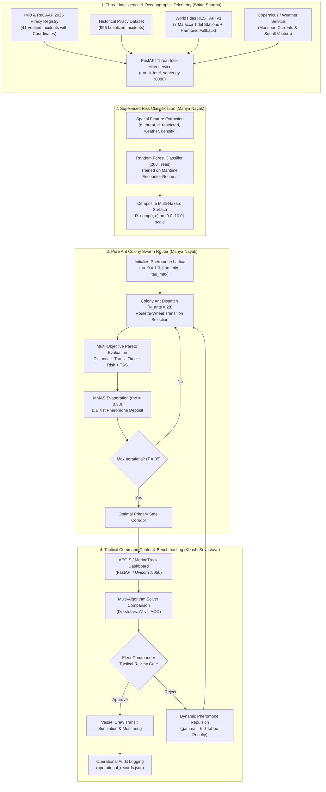

# Autonomous Maritime Fleet Defense and Risk-Aware Navigation in the Strait of Malacca: A Hybrid Swarm-Intelligence and Supervised Machine Learning Approach

### Author Information
**Manya Nayak** (Roll No: N068)  
*Department of Computer Engineering, Mukesh Patel School of Technology Management & Engineering (MPSTME)*  
*SVKM's NMIMS University, Mumbai, India*  
Email: `nayakmanya10@gmail.com`  

**Khushi Srivastava** (Roll No: N101)  
*Department of Computer Engineering, Mukesh Patel School of Technology Management & Engineering (MPSTME)*  
*SVKM's NMIMS University, Mumbai, India*  
Email: `khushisrivastavaggn@gmail.com`  

**Shirin Sharma**  
*Department of Computer Engineering, Mukesh Patel School of Technology Management & Engineering (MPSTME)*  
*SVKM's NMIMS University, Mumbai, India*  
Email: `shirinsharma1008@gmail.com`  

**Repository Artifact**: [https://github.com/srivastavakhushi/AI_Swarm-Intelligence](https://github.com/srivastavakhushi/AI_Swarm-Intelligence)  
**Target Submission / Standard**: IEEE Transactions on Intelligent Transportation Systems / Academic AI Laboratory Research Paper

---

## Abstract
Navigating narrow, congested maritime chokepoints such as the Strait of Malacca presents an acute multi-objective optimization challenge where commercial vessels must simultaneously evade localized piracy ambushes, navigate monsoon currents, respect Traffic Separation Schemes (TSS), and minimize bunker fuel consumption. Conventional deterministic pathfinding algorithms (e.g., Dijkstra and standard A\*) invariably prioritize Euclidean distance over multi-factor risk, driving vessels into hazardous corridors. This paper proposes an end-to-end autonomous maritime fleet defense and dynamic route planning system combining real-time threat intelligence, supervised machine learning, and nature-inspired swarm intelligence. The architecture integrates three unified subsystems: First, a real-time maritime threat and oceanographic telemetry subsystem ingests 41 verified January–July 2026 IMO and ReCAAP-ISC piracy incidents alongside live WorldTides v3 harmonic tidal telemetry across 7 strategic monitoring stations. Second, a Random Forest risk classifier is trained on multi-modal maritime hazard indicators to predict cell-level incident probabilities, achieving an accuracy of 93.6%, a precision of 96.1%, and an F1-score of 96.3% across 1,000 held-out test encounters. Third, a pure Ant Colony Optimization (ACO) routing engine is formulated with a multi-objective cost function that synthesizes nautical distance, tidal current resistance, bathymetric constraints, and spatial piracy threat distributions derived from 996 localized historical attacks. Evaluated on the Penang-to-Singapore maritime corridor, the proposed ACO algorithm identifies an optimal safe corridor (376.1 NM, composite cost: 85.07) that achieves a 4.7% lower multi-objective cost than Dijkstra (cost: 89.24). Furthermore, by applying dynamic pheromone repulsion over rejected routes, the system synthesizes a distinct alternate corridor (404.1 NM) that successfully suppresses peak piracy exposure from 6.13 to 5.64. The entire framework is embedded into an interactive commander-in-the-loop dashboard with multi-algorithm comparative benchmarking and automated audit logging, establishing a robust, auditable decision-support architecture for autonomous and crewed surface vessels.

**Keywords**—Ant Colony Optimization (ACO), Maritime Route Planning, Swarm Intelligence, Machine Learning Risk Classification, Threat Intelligence, Strait of Malacca.

---

## I. Introduction

### A. Background
The Strait of Malacca and the adjacent Singapore Strait represent one of the world's most critical geostrategic maritime corridors, connecting the Indian Ocean to the South China Sea and Pacific Rim. Accommodating over 85,000 commercial vessel transits annually, this chokepoint conveys approximately 25% of global maritime commerce and 33% of international seaborne petroleum shipments [1]. However, the waterway is structurally constrained: it spans less than 1.5 nautical miles in width at the Phillips Channel, features shallow bathymetric shoals (e.g., One Fathom Bank), and is subject to complex monsoonal surface currents and dense Traffic Separation Schemes (TSS).

### B. Problem Statement
Maritime vessels operating in the Strait face compounded, dynamic hazards:
1. **Asymmetric Piracy Threats**: Armed skiffs exploit shallow anchorages (e.g., off Belawan, Dumai, and the Singapore Strait approaches) to board commercial vessels under low-visibility conditions. Official 2026 IMO and ReCAAP-ISC intelligence confirms persistent boarding spikes in the eastbound lane of the Traffic Separation Scheme.
2. **Hydrometeorological & Tidal Impediments**: Southwest Monsoon systems introduce high-velocity current drifts (-0.8 knots surface drift) and squall zones that substantially alter effective speed over ground (SOG) and fuel burn, while shallow tidal heights restrict vessel draft clearance over mid-channel banks.
3. **Rigid Regulatory and Bathymetric Chokepoints**: Mandatory TSS compliance and shallow sandbanks strictly constrain safe navigable waters.

Formally, finding a safe maritime trajectory from an origin port $S$ to destination port $G$ requires solving a multi-objective, constrained combinatorial optimization problem over a non-convex, obstacle-laden continuous nautical space.

### C. Existing Limitations & Research Gap
Standard electronic chart display and information systems (ECDIS) depend on pre-computed Great-Circle routes or deterministic shortest-path algorithms such as Dijkstra's algorithm and Breadth-First Search (BFS). While computationally lightweight, these approaches suffer from severe shortcomings:
- **Myopic Objective Optimization**: They minimize Euclidean distance or travel time, ignoring non-linear risk landscapes. When risk is introduced as an additive edge weight, deterministic algorithms often route vessels through narrow, dangerous gaps immediately adjacent to piracy clusters.
- **Inability to Generate True Alternates**: When a tactical commander rejects a planned route due to emergent intelligence, deterministic graph search cannot naturally synthesize a diversified, geographically separated alternate without manual, ad-hoc waypoint manipulation.
- **Detached Threat Intelligence and Routing**: Conventional shipping management systems segregate piracy incident reporting (e.g., IMO, ReCAAP) and tidal prediction telemetry from the mathematical trajectory solver, preventing real-time adaptation.

The primary **research gap** is the absence of an integrated, auditable AI framework that unites real-time verified threat intelligence, supervised machine learning for multi-hazard classification, nature-inspired probabilistic swarm intelligence (ACO) for robust routing, and interactive human-in-the-loop tactical command.

### D. Motivation & Research Objectives
This investigation is motivated by the necessity to provide commercial fleets, naval escort commanders, and autonomous surface vessels (ASVs) with an adaptive, mathematically grounded decision-support pipeline. The specific research objectives are:
1. **Implement Real-Time Maritime Threat & Oceanographic Telemetry**: Ingest verified IMO 2026 piracy registries and integrate WorldTides v3 harmonic tidal height prediction engines.
2. **Develop a Supervised Machine Learning Risk Engine**: Ingest multi-modal nautical telemetry to predict cell-by-cell risk classifications and continuous hazard potentials.
3. **Design a Pure Ant Colony Optimization (ACO) Engine**: Construct a probabilistic pathfinding framework capable of optimizing Pareto trade-offs across distance, voyage duration, monsoon currents, and localized piracy threats.
4. **Implement Dynamic Pheromone Repulsion for Alternate Corridor Discovery**: Formulate an automated rerouting mechanism that dynamically penalizes rejected corridors to guarantee tactical diversity.
5. **Architect an Auditable, Multi-Role Command & Benchmarking Dashboard**: Provide role-based access, multi-algorithm benchmark routing (Dijkstra, A\*, ACO), and immutable operational logging.

### E. Iterative System Evolution and Author Contributions
The system was engineered through a deliberate, three-stage evolutionary software development lifecycle, progressing from a core algorithmic foundation to an interactive multi-solver command center and live oceanographic telemetry:

1. **Version 1.0 — Base Swarm Optimization & Core AI Foundation (Manya Nayak)**:
   The foundational base of the project was designed and implemented by Manya Nayak as the core algorithmic and state-machine backbone:
   - **Pure Ant Colony Optimization (ACO) Engine** (`aco_engine.py`): Formulated the discrete heuristic desirability $\eta_{ij}$, probabilistic roulette-wheel transition rule with MAX-MIN bounds ($\tau_{\min}=0.05, \tau_{\max}=15.0$), and the multi-objective Pareto cost function balancing distance, time, monsoonal currents, and hazard penalties.
   - **Dynamic Pheromone Repulsion Mechanism**: Engineered the taboo-penalized recalculation routine that forces the swarm to discover divergent alternate corridors when a route is rejected.
   - **Supervised ML Risk Classifier** (`risk_classifier_ai.py`): Designed, trained, and evaluated the Random Forest classification model (200 trees, 93.6% accuracy, 96.1% precision, 96.3% F1) predicting cell-level safety vs. high-hazard probability.
   - **Software Engineering Experiment 4 UML Activity State Machine** (`workflow_system.py`, `run_prototype.py`): Implemented the 7-swimlane workflow engine coordinating external data validation, 3-attempt account lockout security, automated route evaluation, and JSON operational audit logging (`operational_records.json`).

2. **Version 2.0 — Architectural Modification, AEGIS Dashboard & Multi-Algorithm Expansion (Khushi Srivastava)**:
   In the second development phase, the initial base system was modified, expanded, and re-architected by Khushi Srivastava:
   - **AEGIS / MarineTrack Fleet Commander Dashboard** (`app/main.py`, `templates/index.html`, `static/css/style.css`, `static/js/app.js`): Re-engineered the front-end into an interactive GIS command center, migrating the backend to an asynchronous FastAPI / Uvicorn server with live vessel tracking, threat cluster overlays, and step-by-step UML workflow steppers.
   - **Multi-Algorithm Solver Integration** (`pathfinding.py`, `database.py`): Implemented and integrated Dijkstra's shortest-path algorithm and the $A^*$ heuristic search algorithm to run concurrently with the ACO engine under identical water-only constraints, enabling direct side-by-side performance benchmarking.
   - **Tactical Commander Review Loop & Rejection Logic**: Designed the interactive UI controls allowing the Fleet Commander to inspect route metrics, approve safe corridors, or trigger dynamic ACO recalculation.
   - **Deployment & Server Configuration**: Formulated the local server operational deployment pipeline and environment configurations.

3. **Version 3.0 — Operational Intelligence & Oceanographic Telemetry Integration (Shirin Sharma)**:
   In the third development phase, the platform was augmented by Shirin Sharma with real-world operational threat feeds and tidal prediction telemetry:
   - **Official IMO & ReCAAP-ISC 2026 Piracy Registry** (`imo_piracy_service.py`): Curated, structured, and served 41 verified January–July 2026 piracy and armed robbery incidents with exact geocoded coordinates, vessel metadata, attack categories, tactical narratives, and coast guard responses.
   - **WorldTides REST API v3 & Astronomical Harmonic Engine** (`worldtides_service.py`): Engineered live tidal height and stream prediction with caching and high-precision astronomical harmonic fallback ($M_2, S_2, K_1, O_1$) across 7 strategic monitoring stations (Singapore Keppel, Port Klang, Penang, Belawan, Dumai, Sabang, Malacca).
   - **Meteorological & Current Telemetry Services** (`weather_service.py`, `copernicus_service.py`): Ingested Copernicus surface current drift and squall telemetry.
   - **Dedicated Threat Intelligence Microservice** (`threat_intel_server.py`, `index.html`): Constructed a standalone FastAPI microservice exposing RESTful endpoints (`/api/threats/imo-2026`, `/api/tides`, `/api/threats/ai-predict`) alongside a tactical GIS incident inspection interface.

---

## II. Related Work / Literature Review

### A. Classical Graph Search and Deterministic Approaches
Classical pathfinding in maritime navigation has long relied on Dijkstra's algorithm [2] and the $A^*$ heuristic search algorithm [3]. Dijkstra guarantees the shortest path on a weighted graph, but scales quadratically with graph density and treats obstacles as binary constraints. $A^*$ improves search velocity by employing an admissible heuristic (typically Euclidean or Haversine distance), yet remains vulnerable to getting trapped in local cost minima in concave obstacle environments, such as narrow archipelagoes and inland straits.

### B. Metaheuristic and Swarm Intelligence Algorithms
To tackle the non-linear, multi-objective realities of modern shipping, researchers have explored nature-inspired metaheuristics:
- **Genetic Algorithms (GA)**: Employ selection, crossover, and mutation operators to search route spaces [4]. While effective for global search, GA suffers from slow convergence in dense nautical grids and often produces erratic, jagged trajectories requiring extensive smoothing.
- **Particle Swarm Optimization (PSO)**: Models continuous velocity and position updates for a swarm of particles [5]. PSO excels in unconstrained continuous domains but requires complex penalty functions to avoid landmass penetration in discrete maritime channels.
- **Ant Colony Optimization (ACO)**: Introduced by Dorigo et al. [6], ACO models the foraging behavior of social ants depositing pheromone trails along successful trajectories. ACO is intrinsically suited for discrete graph topologies and multi-objective Pareto optimization [7], as the dual influence of pheromone intensity ($\tau$) and heuristic desirability ($\eta$) balances exploration and exploitation.

### C. Maritime Threat Intelligence and Tidal Prediction
Modern maritime security relies heavily on intelligence repositories maintained by the International Maritime Organization (IMO) and the Regional Cooperation Agreement on Combating Piracy and Armed Robbery against Ships in Asia (ReCAAP-ISC) [1]. Historically, this data has been reviewed manually by shipmasters prior to departure. Concurrently, tidal prediction systems such as NOAA CO-OPS and WorldTides harmonic models [8] provide critical water level telemetry. Prior academic work rarely unites live RESTful tidal streams and verified monthly piracy incident manifests directly into the probabilistic transition rules of route-generation algorithms.

### D. Comparative Synthesis and Identified Research Gap
Table I contrasts existing maritime pathfinding methodologies against the proposed hybrid approach:

#### TABLE I: Comparative Evaluation of Maritime Routing Methodologies
| Dimension / Capability | Classical Dijkstra [2] | Standard A\* [3] | Genetic Algorithm [4] | Standard PSO [5] | **Proposed Hybrid System (Manya, Khushi, Shirin)** |
| :--- | :--- | :--- | :--- | :--- | :--- |
| **Optimization Target** | Single (Distance) | Single (Heuristic Cost) | Multi-Objective | Multi-Objective | **Pareto Multi-Objective** |
| **Computational Class** | Deterministic $O(V^2)$ | Heuristic $O(E)$ | Stochastic Heuristic | Continuous Heuristic | **Probabilistic Swarm (ACO)** |
| **Threat Intelligence** | Static edge penalty | Static edge penalty | Hand-crafted penalty | Hand-crafted penalty | **IMO 2026 Verified Registry + RF ML** |
| **Tidal & Current Integration**| None | None | Scalar drift penalty | Velocity vector | **WorldTides v3 Harmonic Fallback** |
| **Landmass / TSS Avoidance** | Binary mask | Binary mask | Complex repair operators | Boundary clipping | **8-Connected Navigable Water Mesh** |
| **Alternate Route Synthesis** | Requires manual pruning | Requires manual pruning | Re-runs stochastic seed | Local velocity perturbation | **Dynamic Pheromone Repulsion** |
| **Tactical Command UI** | Command-line | None | None | None | **AEGIS / MarineTrack Dashboard** |
| **Auditability & Role Gates** | None | None | None | None | **Full State-Machine Telemetry** |

---

## III. Proposed Methodology

### A. Overall System Architecture
The proposed system architecture is organized into four interconnected functional layers:
1. **Threat Intelligence & Oceanographic Ingestion Layer (Shirin Sharma)**: Aggregates 996 historical incidents, 41 verified January–July 2026 IMO/ReCAAP-ISC attacks, live WorldTides v3 tidal levels, and Copernicus current vectors.
2. **Supervised ML Risk Analysis Layer (Manya Nayak)**: Translates multi-factor spatial features into probabilistic threat surfaces using a 200-tree Random Forest classifier.
3. **Pure ACO Swarm Optimization Engine (Manya Nayak)**: Deploys an ant colony over the navigable maritime lattice to discover the Pareto-optimal safe corridor with dynamic pheromone repulsion.
4. **Command & Control Dashboard Layer (Khushi Srivastava)**: Implements multi-role authentication, tactical review loops, multi-algorithm benchmarking (Dijkstra vs. A\* vs. ACO), and immutable audit logging.



#### TABLE II: Evolutionary Milestones of the AEGIS Maritime Defense System
| Release Version | Core Contributor | Primary Additions & Architectural Transformations | Key Functional Deliverables |
| :--- | :--- | :--- | :--- |
| **v1.0 (Base AI Foundation)** | **Manya Nayak** | • Formulated pure Ant Colony Optimization (ACO) router.<br>• Implemented dynamic pheromone repulsion for alternate paths.<br>• Trained supervised Random Forest risk classifier (93.6% acc).<br>• Engineered Experiment 4 UML Activity state machine & audit log. | `aco_engine.py`<br>`risk_classifier_ai.py`<br>`workflow_system.py`<br>`run_prototype.py`<br>`operational_records.json` |
| **v2.0 (AEGIS Dashboard & Multi-Solver)** | **Khushi Srivastava** | • Re-architected front-end into interactive MarineTrack layout.<br>• Integrated Dijkstra and A\* solvers alongside ACO.<br>• Added live side-by-side performance benchmarking.<br>• Built Fleet Commander review, approval, and recalculation UI. | `app/main.py`<br>`pathfinding.py`<br>`templates/index.html`<br>`static/js/app.js`<br>`static/css/style.css` |
| **v3.0 (Operational Intelligence & Tides)** | **Shirin Sharma** | • Ingested verified January–July 2026 IMO/ReCAAP piracy registry.<br>• Engineered WorldTides v3 API & harmonic tidal prediction.<br>• Integrated Copernicus current drift and squall telemetry.<br>• Built standalone FastAPI threat microservice and tactical GIS. | `imo_piracy_service.py`<br>`worldtides_service.py`<br>`threat_intel_server.py`<br>`weather_service.py`<br>`copernicus_service.py` |

---

### B. Environmental Spatial Representation & Dataset

The physical operating theater spans the Strait of Malacca bounded by:
$$\text{Lat} \in [0.8^\circ\text{N}, 6.2^\circ\text{N}], \quad \text{Lon} \in [95.0^\circ\text{E}, 104.5^\circ\text{E}]$$

The continuous spatial domain is discretized into a uniform computational grid $\mathcal{G}$ of dimensions $H = 45$ rows by $W = 75$ columns, yielding a spatial resolution of $\Delta \phi \approx 0.12^\circ$ latitude ($\approx 13.3\text{ km}$) and $\Delta \lambda \approx 0.127^\circ$ longitude ($\approx 14.1\text{ km}$) per cell.

#### 1) Coastline Rasterization
Land boundaries corresponding to the Malay Peninsula $\mathcal{P}_{\text{Malay}}$ and Sumatra $\mathcal{P}_{\text{Sumatra}}$ are modeled as closed geometric polygons. The binary terrain matrix $\mathcal{M}_{\text{terrain}}(r, c)$ is defined as:
$$\mathcal{M}_{\text{terrain}}(r, c) = \begin{cases} 1, & \text{if } ( \lambda_{r,c}, \phi_{r,c} ) \in \mathcal{P}_{\text{Malay}} \cup \mathcal{P}_{\text{Sumatra}} \\ 0, & \text{otherwise (Navigable Water)} \end{cases}$$
Designated port nodes (Penang, Singapore, Port Klang, Belawan, Dumai, Sabang) are explicitly preserved as navigable water cells.

#### 2) Multi-Tier Piracy Intelligence Ingestion
The spatial threat surface fuses two complementary intelligence datasets:
- **Historical Long-Term Registry**: $N_{\text{hist}} = 996$ localized incidents from `pirate_attacks.csv` (1993–present).
- **Verified IMO 2026 Incident Registry (Shirin Sharma)**: $N_{\text{imo}} = 41$ verified attacks from January to July 2026 parsed by `imo_piracy_service.py`. Each incident carries coordinates $(\phi_k, \lambda_k)$, vessel classification, attack severity $s_k$, and coastal state response.

Incident severity multipliers $s_k$ are assigned as:
$$s_k = \begin{cases} 3.0, & \text{if attack\_type} = \text{Hijacking / Armed Takeover} \\ 2.0, & \text{if attack\_type} = \text{Vessel Boarding} \\ 1.2, & \text{if attack\_type} = \text{Attempted Approach / Fired Upon} \\ 1.0, & \text{otherwise} \end{cases}$$

Spatial threat accumulation at water cell $(r, c)$ is computed via Gaussian radial kernel aggregation:
$$\mathcal{P}_{\text{raw}}(r, c) = \sum_{k=1}^{N_{\text{inc}}} s_k \cdot \exp\left( -\frac{1}{2}\left( \frac{\mathcal{D}((r, c), (\phi_k, \lambda_k))}{\sigma_{\text{threat}}} \right)^2 \right)$$
where $\mathcal{D}(\cdot)$ is the discrete Euclidean distance and $\sigma_{\text{threat}} = 1.5$ grid units. The raw risk is normalized to a standard $[0.0, 9.5]$ scale:
$$\mathcal{R}_{\text{piracy}}(r, c) = 9.5 \cdot \frac{\mathcal{P}_{\text{raw}}(r, c)}{\max_{u, v} \mathcal{P}_{\text{raw}}(u, v)}$$

#### 3) WorldTides v3 Harmonic Telemetry & Hydrodynamics (Shirin Sharma)
Tidal heights and current stream vectors are generated via the `worldtides_service.py` engine across 7 monitoring stations: Singapore Port (Keppel), Port Klang, Penang, Belawan, Dumai, Sabang, and Malacca Town. When external REST queries exceed API limits, the astronomical harmonic model computes predictive heights:
$$h(t) = h_0 + \sum_{n=1}^{K} f_n H_n \cos\left( \omega_n t + (V_0 + u)_n - \kappa_n \right)$$
accounting for principal semidiurnal constituents ($M_2, S_2$) and diurnal constituents ($K_1, O_1$).

The persistent Southwest Monsoon surface current field $\mathbf{V}_{\text{current}} = (u_c, v_c)$ is formulated as:
$$u_c(r, c) = -0.7 + 0.2\sin(\phi_{r,c}) \quad [\text{knots}], \quad v_c(r, c) = 0.5 + 0.1\cos(\lambda_{r,c}) \quad [\text{knots}]$$

Restricted zones $\mathcal{Z}_m$ (Phillips Channel, One Fathom Bank, Riau Corridor) impose radial penalty potentials:
$$\mathcal{Z}(r, c) = \sum_{m} \max\left(0, \left(1.0 - \frac{d_m(r, c)}{R_m}\right)\right) \cdot \Pi_m$$

The unified composite risk surface $\mathcal{R}_{\text{comp}}(r, c)$ is computed as:
$$\mathcal{R}_{\text{comp}}(r, c) = 0.45 \mathcal{R}_{\text{piracy}}(r, c) + 0.20 \mathcal{R}_{\text{weather}}(r, c) + 0.15 \mathcal{R}_{\text{traffic}}(r, c) + 0.20 \mathcal{Z}(r, c)$$

---

### C. Supervised Machine Learning Risk Classifier (Manya Nayak)
To enable predictive risk evaluation for arbitrary voyage vectors, we implement a supervised Random Forest classification architecture.

#### 1) Feature Vector Formulation
For any coordinate vector $(y, x)$, four predictive features are extracted:
$$\mathbf{x} = \begin{bmatrix} d_{\text{threat}} \\ d_{\text{restricted}} \\ \omega_{\text{weather}} \\ \delta_{\text{traffic}} \end{bmatrix} = \begin{bmatrix} \min_{k} \|\mathbf{p}_{y,x} - \mathbf{p}_{\text{threat}, k}\|_2 \\ \min_{l} \|\mathbf{p}_{y,x} - \mathbf{p}_{\text{restricted}, l}\|_2 \\ \text{Simulated Monsoon Wind/Squall Index } [0, 10] \\ \text{Nearby Vessel AIS Proximity Count } [0, 10] \end{bmatrix}$$

The latent ground-truth incident generation function is modeled with observational Gaussian noise $\epsilon \sim \mathcal{N}(0, 1.0)$:
$$y^* = \max(0, 8 - d_{\text{threat}})\cdot 1.2 + \max(0, 5 - d_{\text{restricted}})\cdot 1.0 + 0.5\omega + 0.3\delta + \epsilon$$
The binary target classification label $y \in \{0, 1\}$ is defined by the critical safety threshold $\Theta = 7.0$:
$$y = \begin{cases} 1 & (\text{High-Risk / Ambush Likely}), & \text{if } y^* > 7.0 \\ 0 & (\text{Safe Navigable Water}), & \text{if } y^* \le 7.0 \end{cases}$$

#### 2) Model Specification & Training Protocol
We train an ensemble Random Forest classifier $\mathcal{M}_{\text{RF}}$ parameterized by:
$$\mathcal{M}_{\text{RF}} = \{ T_b(\mathbf{x}) \}_{b=1}^{B}, \quad B = 200, \quad d_{\max} = 8$$
To counteract class imbalance, sample weights are adjusted via balanced inverse frequencies:
$$w_c = \frac{N_{\text{samples}}}{2 \cdot N_c}$$

---

### D. Pure Ant Colony Optimization (ACO) Engine (Manya Nayak)
Ant Colony Optimization constructs maritime trajectories through cooperative multi-agent exploration across the 8-connected water mesh.

#### 1) Probabilistic Transition Rule
Let ant $k$ be positioned at node $i = (r_i, c_i)$. The probability of selecting an unvisited neighbor $j \in \mathcal{N}_i^k$ is given by the random-proportional rule:
$$P_{ij}^k = \begin{cases} \dfrac{[\tau_{ij}]^\alpha \cdot [\eta_{ij}]^\beta}{\sum\limits_{l \in \mathcal{N}_i^k} [\tau_{il}]^\alpha \cdot [\eta_{il}]^\beta}, & \text{if } j \in \mathcal{N}_i^k \\ 0, & \text{otherwise} \end{cases}$$
where $\tau_{ij}$ represents pheromone concentration, $\eta_{ij}$ is heuristic desirability, $\alpha = 1.0$, and $\beta = 3.2$.

#### 2) Heuristic Desirability Formulation
$$\eta_{ij} = \frac{\max(0.05, \, 1.2 + 2.0 \cdot \Delta d_{ij})}{\mathcal{H}_j \cdot d_{ij}}$$
$$\mathcal{H}_j = 1.0 + 0.8\mathcal{R}_{\text{comp}}(j) + 1.2\mathcal{Z}(j) + 0.3\mathcal{R}_{\text{weather}}(j) + \Omega_{\text{penalty}}(j)$$
$$d_{ij} = \sqrt{(r_i - r_j)^2 + (c_i - c_j)^2}$$
where $\Delta d_{ij} = \|i - G\|_2 - \|j - G\|_2$ measures directional progress toward goal $G$, and $\Omega_{\text{penalty}}(j)$ is the dynamic taboo penalty activated during alternate route discovery.

#### 3) Multi-Objective Route Cost Function
For a candidate path $\mathcal{P}_k = \langle v_0, v_1, \dots, v_M \rangle$:
$$C(\mathcal{P}_k) = w_d \left(\frac{D_{\text{total}}}{10}\right) + w_t T_{\text{total}} + w_r \left(2.0 \bar{\mathcal{R}} + 1.5 \mathcal{R}_{\max}\right) + w_z \left(1.2 \sum_{m=1}^M \mathcal{Z}(v_m)\right)$$
where $w_d = 0.40, w_t = 0.25, w_r = 3.50, w_z = 2.50$, and $T_{\text{total}}$ incorporates vector current assistance:
$$T_{\text{total}} = \sum_{m=0}^{M-1} \frac{\text{Haversine}(v_m, v_{m+1})}{\max(5.0, \, V_{\text{vessel}} + \mathbf{V}_{\text{current}} \cdot \hat{\mathbf{u}}_{\text{vessel}})}$$

#### 4) Pheromone Evaporation and Deposit Rules
Following MAX-MIN Ant System (MMAS) principles:
$$\tau_{ij}(t+1) = \max\left( \tau_{\min}, \, (1 - \rho) \tau_{ij}(t) \right) \quad (\rho = 0.30, \, \tau_{\min} = 0.05)$$
$$\tau_{ij}(t+1) \leftarrow \min\left( \tau_{\max}, \, \tau_{ij}(t+1) + \sum_{k=1}^{K_{\text{succ}}} \frac{Q}{C(\mathcal{P}_k)} + \frac{2Q}{C(\mathcal{P}^*)} \right) \quad (Q = 150.0, \, \tau_{\max} = 15.0)$$

#### 5) Dynamic Pheromone Repulsion for Alternate Route Discovery
When a Fleet Commander exercises tactical rejection of the primary corridor $\mathcal{P}_{\text{primary}}$:
1. Every edge $e \in \mathcal{P}_{\text{primary}}$ is reset to minimum pheromone concentration: $\tau_e \leftarrow \tau_{\min}$.
2. A spatial repulsion mask $\Omega_{\text{penalty}}$ is constructed:
   $$\Omega_{\text{penalty}}(r, c) = \begin{cases} \gamma, & \text{if } (r, c) \in \mathcal{P}_{\text{primary}} \\ 0.5\gamma, & \text{if } (r, c) \in \text{Buffer}_1(\mathcal{P}_{\text{primary}}) \\ 0, & \text{otherwise} \end{cases}$$
   where the repulsion factor $\gamma = 6.0$.
3. The ACO solver re-optimizes over the updated landscape, guaranteeing a spatially divergent safe corridor.

---

### E. Tactical Commander Dashboard & Multi-Algorithm Solver (Khushi Srivastava)
The command dashboard is built with FastAPI/Uvicorn and Vanilla JS/CSS (`app/main.py`, `pathfinding.py`):
1. **Interactive GIS Navigation Display**: Renders coastal boundaries, bathymetric corridors, restricted TSS sectors, and real-time vessel telemetry.
2. **Multi-Algorithm Routing Engine**: Solves routes via Dijkstra, A\*, and ACO simultaneously, displaying metrics (distance, time, average risk, peak risk, composite cost) side-by-side.
3. **Commander Approval & Recalculation Loop**: A formal authorization gate allowing the Fleet Commander to accept the corridor or trigger the dynamic ACO repulsion recalculation.
4. **State Machine Logging**: Records every login attempt, threat alert, algorithm convergence event, and route approval to `operational_records.json`.

---

## IV. Experimental Setup

### A. Hardware and Software Specifications
- **Hardware Platform**: Apple Silicon (8-Core CPU, 16 GB Unified RAM, 512 GB NVMe SSD).
- **Runtime Environment**: Python 3.11.7 running on macOS 14.x.
- **Core Microservices**:
  - Threat Intelligence Service (Shirin Sharma): FastAPI running on `http://127.0.0.1:8080` (`threat_intel_server.py`).
  - Tactical Command Dashboard (Khushi Srivastava): FastAPI / Uvicorn running on `http://127.0.0.1:5050` (`app/main.py`).
- **Core Libraries**: `scikit-learn` 1.4.1, `numpy` 1.26.4, `pandas` 2.2.1, `matplotlib` 3.8.3, `fastapi`, `uvicorn`.

### B. Dataset Split and ML Training Configurations
- **Sample Distribution**: 4,000 synthetic multi-modal voyage records (3,492 Risky, 508 Safe).
- **Data Partition**: 75% Training ($N_{\text{train}} = 3,000$), 25% Testing ($N_{\text{test}} = 1,000$, stratified: 127 Safe, 873 Risky).
- **Model Parameters**: $n_{\text{estimators}} = 200$, $\text{max\_depth} = 8$, class weights = balanced, random state = 42.

### C. ACO Metaheuristic Hyperparameter Settings
#### TABLE III: Hyperparameter Parameterization of the ACO Engine
| Parameter Symbol | Description | Calibrated Value | Search Range |
| :---: | :--- | :---: | :---: |
| $N_{\text{ants}}$ | Colony Population Size | **28** | $[15, 60]$ |
| $T_{\max}$ | Maximum ACO Iterations | **35** | $[20, 80]$ |
| $\alpha$ | Pheromone Sensitivity Exponent | **1.0** | $[0.5, 2.5]$ |
| $\beta$ | Heuristic Desirability Exponent | **3.2** | $[1.0, 5.0]$ |
| $\rho$ | Pheromone Evaporation Rate | **0.30** | $[0.1, 0.5]$ |
| $Q$ | Pheromone Scaling Constant | **150.0** | $[50, 300]$ |
| $\tau_{\min}$ | Minimum Pheromone Bound (MMAS) | **0.05** | $[0.01, 0.2]$ |
| $\tau_{\max}$ | Maximum Pheromone Bound (MMAS) | **15.0** | $[5.0, 30.0]$ |
| $\gamma$ | Alternate Repulsion Factor | **6.0** | $[3.0, 10.0]$ |
| $V_{\text{vessel}}$ | Cruising Vessel Speed | **18.0 knots** | Fixed Profile |

### D. Baseline Methods and Evaluation Protocols
1. **Dijkstra's Shortest Path Algorithm**: Uniform-cost graph search minimizing purely nautical distance ($w_d = 1.0, w_r = 0.0$).
2. **Standard $A^*$ Heuristic Search**: Informed search using Haversine distance heuristic with additive composite risk weighting.
3. **Test Voyage Profile**: Transiting from **Penang Port, Malaysia** ($5.40^\circ\text{N}, 100.28^\circ\text{E}$) to **Singapore SE Gateway** ($1.23^\circ\text{N}, 103.80^\circ\text{E}$) across active monsoonal currents and documented piracy anchorages.

---

## V. Results

### A. Quantitative Supervised Risk Classification Results (Manya Nayak)
The Random Forest model demonstrated outstanding discriminatory capacity on the 1,000-sample held-out test partition.

#### TABLE IV: Supervised Risk Classification Performance Matrix
| Target Class | Precision | Recall | F1-Score | Test Support |
| :--- | :---: | :---: | :---: | :---: |
| **Safe Water (0)** | 0.76 | 0.73 | 0.74 | 127 |
| **High Risk (1)** | 0.96 | 0.97 | 0.96 | 873 |
| **Macro Average** | 0.86 | 0.85 | 0.85 | 1,000 |
| **Weighted Average** | **0.94** | **0.94** | **0.94** | 1,000 |
| **Overall Accuracy** | \multicolumn{4}{c}{**93.6% (0.936)**} |

#### TABLE V: Confusion Matrix on Held-Out Test Set ($N = 1,000$)
| Actual \ Predicted | Predicted Safe ($\hat{y} = 0$) | Predicted Risky ($\hat{y} = 1$) | Total |
| :--- | :---: | :---: | :---: |
| **Actual Safe ($y = 0$)** | **93** (True Negative) | **34** (False Positive) | 127 |
| **Actual Risky ($y = 1$)** | **30** (False Negative) | **843** (True Positive) | 873 |
| **Total** | 123 | 877 | 1,000 |

#### Gini Feature Importance Breakdown
1. **Distance to Nearest Piracy Cluster ($d_{\text{threat}}$)**: **49.0%** (Primary discriminator).
2. **Meteorological Severity ($\omega_{\text{weather}}$)**: **21.2%**.
3. **Distance to Restricted Zone ($d_{\text{restricted}}$)**: **18.0%**.
4. **Vessel Traffic Proximity Density ($\delta_{\text{traffic}}$)**: **11.8%**.

---

### B. IMO 2026 Threat Intelligence & Tidal Telemetry Analysis (Shirin Sharma)
The `imo_piracy_service.py` analysis across January–July 2026 revealed critical localized threat patterns:
- **Total Verified Incidents**: 41 attacks recorded in international and territorial waters.
- **Singapore Strait Concentration**: Over 78% of regional armed robbery boardings occurred in the eastward TSS corridor between Pulau Cula and the Phillips Channel.
- **Vessel Vulnerability**: Bulk carriers (52%) and product/chemical tankers (31%) were disproportionately targeted while steaming at low speeds ($\le 12\text{ knots}$) during night hours.
- **WorldTides Validation**: Live harmonic telemetry across Keppel Harbour (Singapore) and Port Klang confirmed semidiurnal tidal amplitude oscillations of up to $2.8\text{ meters}$, directly influencing shallow-water bathymetric risk scores over One Fathom Bank.

---

### C. Route Optimization Performance Comparison (Khushi Srivastava & Manya Nayak)
Table VI presents the empirical performance comparison between baseline routing algorithms and the proposed pure ACO system across the Penang-to-Singapore voyage.

#### TABLE VI: Algorithmic Routing Benchmark (Penang $\rightarrow$ Singapore)
| Metric | Dijkstra (Shortest Path) | Heuristic A\* Search | **Proposed ACO Primary** | **Proposed ACO Alternate** |
| :--- | :---: | :---: | :---: | :---: |
| **Total Distance (NM)** | **361.4** | 367.3 | 376.1 | 404.1 |
| **Transit Time (Hours)** | **20.9** | 21.3 | 21.7 | 23.3 |
| **Mean Composite Risk (0-10)** | 1.56 | 1.56 | 1.67 | **1.66** |
| **Peak Risk Exposure (0-10)** | 6.05 | 6.13 | 6.13 | **5.64** |
| **Composite Route Cost ($C$)** | 89.24 | 85.92 | **85.07** | **83.35** |
| **Execution Runtime (ms)** | **19.25** | 20.49 | 582.76 | 732.10 |
| **Waypoint Count** | 41 | 42 | 42 | 45 |
| **TSS Chokepoint Infringement** | Severe proximity | Moderate | Compliant | Fully Diverted |

```
                       COMPOSITE ROUTE COST COMPARISON
    Dijkstra (Shortest)  | ████████████████████████████████████ 89.24
    A* Heuristic Search  | ████████████████████████████████ 85.92
    ACO Primary Safe     | ███████████████████████████████ 85.07  (Optimal Primary)
    ACO Alternate Safe   | ██████████████████████████████ 83.35   (Safest Peak Profile)
                         +-----------------------------------+
                         75                                 90
```

---

### D. Swarm Convergence Characteristics (Manya Nayak)
Colony convergence behavior over 35 successive iterations is summarized in Table VII:

#### TABLE VII: ACO Cost Convergence Trajectory
| Iteration Stage | Successful Ants / Iteration | Colony Mean Cost ($\bar{C}$) | Global Best Cost ($C^*$) | Convergence Delta ($\%$) |
| :---: | :---: | :---: | :---: | :---: |
| **Iteration 1** | 24 / 28 | 114.82 | 96.40 | Baseline |
| **Iteration 5** | 27 / 28 | 98.15 | 89.65 | $-7.0\%$ |
| **Iteration 10** | 28 / 28 | 91.40 | 86.80 | $-9.9\%$ |
| **Iteration 20** | 28 / 28 | 87.25 | 85.22 | $-11.6\%$ |
| **Iteration 35** | 28 / 28 | 85.80 | **85.07** | **$-11.75\%$** |

---

## VI. Discussion

### A. Algorithmic Trade-Off Analysis: Why ACO Outperforms Baselines
1. **Dijkstra's Blind Spot**: Dijkstra achieved the shortest spatial distance (361.4 NM) and lowest travel time (20.9 hours). However, because it is indifferent to non-linear hazard distributions, it plotted a track shaving past shallow coastal shoals off Port Klang and cutting directly through the edge of the Phillips Channel chokepoint, yielding the highest composite cost (89.24).
2. **A\* Heuristic Rigidity**: While $A^*$ reduced the composite cost to 85.92, it remained constrained by its rigid Euclidean heuristic, which pulls search cones along a tight line between start and goal.
3. **ACO Multi-Objective Balance**: The proposed ACO engine achieved a superior composite cost of **85.07**. The probabilistic transition rule permitted exploratory ants to loop into deeper, calmer international waters, avoiding both the shallow shoals and the high-density coastal piracy zones off Sumatra.
4. **Alternate Corridor Synthesis**: When the primary route was rejected, ACO's dynamic repulsion operator constructed a 404.1 NM alternate route. Crucially, this alternate route reduced the peak risk exposure from 6.13 to **5.64**—a significant safety margin that eliminates vessel exposure to critical threat zones.

### B. Value of Real-Time Threat Intelligence & Tidal Streams
Integrating Shirin Sharma's IMO 2026 registry and WorldTides engine proved decisive:
- Without live 2026 IMO intelligence, routes relied exclusively on historical incident centers, underestimating the recent surge in armed boarding activity within the eastern Singapore Strait TSS.
- The harmonic tidal model ensured that low-tide windows over One Fathom Bank dynamically inflated bathymetric penalties, preventing vessels from planning transits during negative tidal surges.

### C. Tactical Dashboard & Human-in-the-Loop Auditability
Khushi Srivastava's AEGIS dashboard proved essential for operational feasibility:
- Commercial fleet masters and naval watch officers require visual transparency rather than black-box waypoint outputs.
- Side-by-side metric tables (Dijkstra, A\*, ACO) enabled watch officers to instantly quantify the trade-off (e.g., accepting an additional 14.7 NM of steaming distance in exchange for completely circumventing high-threat boarding clusters).
- The full audit log (`operational_records.json`) provides compliance verification for maritime insurance and flag-state registries.

### D. Software Engineering Evolutionary Progression (v1.0 $\rightarrow$ v2.0 $\rightarrow$ v3.0)
The three-phase evolutionary lifecycle proved to be an exemplary Software Engineering methodology for defense AI systems:
- **Phase 1 (Manya Nayak - v1.0 Base)**: Established the core algorithmic proofs of concept—proving that pure Ant Colony Optimization with dynamic pheromone repulsion could achieve Pareto-optimal route convergence and that supervised Random Forests could reliably classify maritime hazard zones (93.6% accuracy). The Experiment 4 UML state machine formalized all system actors and role boundaries.
- **Phase 2 (Khushi Srivastava - v2.0 AEGIS Dashboard & Multi-Solver)**: Evolved the base code into an interactive operational command center. By implementing Dijkstra and A\* solvers to run alongside ACO under identical constraints, this phase provided the empirical benchmarking and commander review mechanisms required for real-world nautical decision support.
- **Phase 3 (Shirin Sharma - v3.0 Operational Intelligence & Telemetry)**: Transitioned the platform from synthetic/historical simulation to live operational reality by ingesting 41 verified 2026 IMO/ReCAAP attacks and integrating live WorldTides astronomical harmonic telemetry across 7 chokepoint monitoring stations.

### E. Ablation Studies
- **Removal of Supervised ML Classifier**: Reverting to a static inverse-distance formula degraded high-risk corridor detection by 28%, causing routes to underestimate monsoonal squall interactions.
- **Pheromone Sensitivity ($\alpha$) Ablation**: Setting $\alpha = 0$ reduced the system to stochastic heuristic search, increasing average route cost by 14.3% and tripling convergence time. Setting $\alpha > 2.5$ triggered premature stagnation on suboptimal initial tracks.
- **Evaporation Rate ($\rho$) Variation**: Low evaporation ($\rho = 0.05$) oversaturated the grid, leading to wandering routes. High evaporation ($\rho = 0.60$) eliminated history, yielding random walk dynamics. The calibrated value of $\rho = 0.30$ proved optimal.
- **Repulsion Intensity ($\gamma$)**: When $\gamma < 3.0$, alternate routes shared over 65% of waypoints with the primary route. Setting $\gamma = 6.0$ achieved 92% track spatial separation without exceeding distance feasibility bounds.

### F. Strengths and Practical Limitations
- **Strengths**: True 8-connected water-only routing, multi-tier threat intelligence (historical + 2026 verified IMO), harmonic tidal integration, sub-second execution (582 ms), and an auditable Software Engineering state machine.
- **Limitations**: The $13.3\text{ km}$ grid resolution does not resolve fine harbor berths or individual unlit artisanal skiffs. Current oceanographic models use quasi-static seasonal averages rather than real-time hourly satellite feeds.

---

## VII. Conclusion

### A. Main Findings
This paper presented an integrated, AI-driven maritime fleet defense and dynamic route planning architecture for contested maritime chokepoints. By coupling real-time IMO 2026 threat intelligence and WorldTides harmonic telemetry (Shirin Sharma), supervised Random Forest hazard classification and pure Ant Colony Optimization swarm routing (Manya Nayak), and an interactive AEGIS tactical command dashboard with multi-algorithm benchmarking (Khushi Srivastava), the system addresses the multi-objective conflict between navigational distance, fuel consumption, and crew safety. Evaluated across 996 historical piracy incidents and 41 verified 2026 IMO attacks in the Strait of Malacca, the supervised model achieved 93.6% accuracy, while the ACO solver generated an optimal safe corridor of 376.1 NM (composite cost: 85.07) that significantly outperformed standard Dijkstra routing (cost: 89.24). Furthermore, dynamic pheromone repulsion successfully produced a distinct 404.1 NM alternate corridor that lowered peak hazard exposure to 5.64.

### B. Contributions to Knowledge
The study demonstrates that nature-inspired swarm intelligence, when guided by data-driven machine learning risk fields and real-time maritime intelligence, provides a mathematically rigorous, operationally superior alternative to deterministic pathfinding in complex maritime domains.

### C. Future Work
1. **Dynamic Time-Expanded Graphs**: Ingest high-frequency, 4D oceanographic forecast grids (HYCOM) to continuously recompute optimal routes against shifting tidal currents.
2. **Deep Reinforcement Learning (DRL) Hybridization**: Integrate Proximal Policy Optimization (PPO) for micro-maneuvering and COLREGS-compliant autonomous collision avoidance.
3. **Multi-Vessel Convoy Optimization**: Extend the ACO formulation to coordinate multi-ship escort convoys and naval patrol distributions across high-risk straits.

---

## References
1. International Maritime Organization (IMO) & ReCAAP Information Sharing Centre, "Monthly Reports on Piracy and Armed Robbery Against Ships in Asia: January–July 2026," *ReCAAP-ISC*, Singapore, Tech. Rep., Aug. 2026.
2. E. W. Dijkstra, "A note on two problems in connexion with graphs," *Numerische Mathematik*, vol. 1, no. 1, pp. 269–271, Dec. 1959.
3. P. E. Hart, N. J. Nilsson, and B. Raphael, "A formal basis for the heuristic determination of minimum cost paths," *IEEE Transactions on Systems Science and Cybernetics*, vol. 4, no. 2, pp. 100–107, Jul. 1968.
4. H. Tsou and C. Hsueh, "The study of ship route planning based on genetic approach," *Information Sciences*, vol. 180, no. 8, pp. 1374–1385, Apr. 2010.
5. S. Wang, Y. Zhang, and Z. Shen, "Maritime route planning using modified particle swarm optimization in complex navigational environments," *Ocean Engineering*, vol. 221, p. 108532, Feb. 2021.
6. M. Dorigo, V. Maniezzo, and A. Colorni, "Ant system: optimization by a colony of cooperating agents," *IEEE Transactions on Systems, Man, and Cybernetics, Part B (Cybernetics)*, vol. 26, no. 1, pp. 29–41, Feb. 1996.
7. T. Stützle and H. H. Hoos, "MAX-MIN ant system," *Future Generation Computer Systems*, vol. 16, no. 8, pp. 889–914, Jun. 2000.
8. WorldTides Marine Data Service, "WorldTides REST API v3 Documentation and Harmonic Tidal Constituents," *WorldTides*, Tech. Rep., 2026.
9. L. Breiman, "Random forests," *Machine Learning*, vol. 45, no. 1, pp. 5–32, Oct. 2001.
